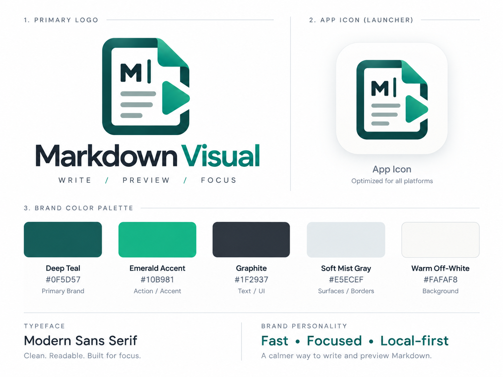

  <h1>Markdown Visual</h1>
  
The fast, local-first, visual Markdown editor.

  

Welcome to the official public release repository for **Markdown Visual**. 

🌐 **Official Website:** [https://markdown.io.vn/](https://markdown.io.vn/)

## 📥 Download

Get the latest version of Markdown Visual for your operating system by visiting our [**Latest Release**](https://github.com/leotrinh/markdown-visual-releases/releases/latest) page:

- 🪟 **Windows:** Download the `*setup.exe` installer.
- 🍏 **macOS:** Download the `.dmg` package.
- 🐧 **Linux:** Download the `.AppImage` package.

*(Tip: For Windows, a `SHA256SUMS.txt` file is also provided to verify the integrity of the installer).*

## 📝 Changelog

Curious about new features, improvements, and bug fixes? 

👉 **[Read the full Changelog here](CHANGELOG.md)**

## 🚀 Roadmap: What is Next

### Free core. Bigger ideas, funded by users.
The focused local Markdown workflow stays free. Community support can fund optional cloud and AI features without making the core app heavier.

#### 🟢 Markdown Visual Core (FREE - AVAILABLE NOW)
Fast, private and local-first — the essentials remain free.
- Open and preview Markdown
- Browse folders and recent files
- Workspace search
- Edit with live preview

#### 🟡 AI writing & public sharing (OPTIONAL SUBSCRIPTION - EXPLORING)
Extra capabilities for people who want more — without changing the free core.
- Generate Markdown and get inline suggestions with your configured LLM
- Publish Markdown as a static HTML page with a public share link

> *Built when community support makes it sustainable — no dates and no rushed promises.*
